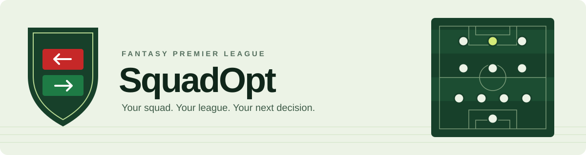

# SquadOpt

<p align="center">
  
</p>

<p align="center">
  <a href="https://github.com/MyManDev/football-squad-optimizer/actions/workflows/ci.yml"></a>
  
  
  
  <a href="LICENSE"></a>
</p>

<p align="center">
  <a href="https://squadopt.mymandev.com">Open SquadOpt</a> ·
  <a href="#development">Get started</a> ·
  <a href="ARCHITECTURE.md">Architecture</a> ·
  <a href="docs/README.md">Documentation</a> ·
  <a href="CONTRIBUTING.md">Contribute</a>
</p>

**A Fantasy Premier League decision workspace, from captured data to the squad on the pitch.**

SquadOpt brings transfers, captain choices, fixtures and league results into one member
website. A Python decision engine builds reproducible weekly plans; React and TypeScript
present them, and a Web Worker running HiGHS computes supported one-week plans on the
member's device. The optional advice API and its workers serve additional requests.

| Plan your week | Follow your league | Trace every decision |
| --- | --- | --- |
| Squad and bench on the pitch, transfer boards, captain choices and fixtures | Member views, the league table, settled history and the league race | Captured inputs, versioned contracts, provenance and offline verification |

The currently published league is **352490**. Enter its number on the site, choose your
member, and open your squad. The member selection is a navigation preference, not an account
or authentication system. The [league list](config/leagues.json) and published capabilities
define what is available; the [roadmap](docs/product/roadmap.md#current-position) records the
product's scope and evidence.

## How it fits together

```text
Captured FPL inputs
        |
        v
Python application + decision engine
        |
        v
Versioned weekly publication -----> React member website
                                         |          |
                              One-week device    Optional advice
                              worker (HiGHS)     API + workers
```

The product and the research laboratory share a repository with enforced import boundaries.
Research records document measured results; installing research code does not activate a
model. Start with the [architecture overview](ARCHITECTURE.md),
[documentation guide](docs/README.md) or [system map](docs/architecture/system_map.md).
[ADR 0007](docs/architecture/decisions/0007-enterprise-transition.md) records the enterprise
transition and its acceptance boundaries.

## Repository layout

The installed Python package is `squadopt`, arranged in dependency rings from R1 (innermost) to
R5; `scripts/` and `tests/` sit outside it. [ARCHITECTURE.md](ARCHITECTURE.md) gives the ring of
every package.

| Path | Responsibility |
| --- | --- |
| [`ARCHITECTURE.md`](ARCHITECTURE.md) | Rings, deployment units, scaling seams, enforcement and known violations |
| [`src/squadopt/`](src/squadopt/README.md): product rings | `contracts` and the schema half of `data` (R1, vocabulary); `features`, `prediction`, `optimization`, `planning`, `scenarios`, `evaluation` and `live` (R2, domain); `application` and `integration` (R3, use cases); `platform`, `api` and the storage half of `data` (R4 adapters and R5 composition) |
| `src/squadopt/`: research arm | `experiments`, `backtest`, `bayesopt`, `recalibration` and `preflight`, the measurement laboratory; no product package may import it |
| [`scripts/`](scripts/README.md) | Repository commands, measurement runners, fixture generators and the release recipe, catalogued by role |
| [`web/`](web/README.md) | Member website, runtime publication validation, the in-browser device solver and browser tests |
| [`workers/`](workers/README.md) | Cloudflare Workers deployed separately from the static site (today only the [FPL probe](docs/fpl_forwarder_probe.md)) |
| [`deploy/`](deploy/README.md) | Deployment configuration for the separate API and worker processes |
| [`config/`](config/README.md) | Operator configuration read at run time: the list of leagues the site serves |
| [`tests/`](tests/README.md) | Offline unit tests, architecture fitness functions, shared fixtures and opt-in acceptance probes |
| [`docs/`](docs/README.md) | Product, operations, architecture, specifications, contracts and scientific evidence |
| [`data/`](data/README.md) | Private local operational state; a Git checkout is not its backup |
| `.github/` | CI, the Pages deployment, the backend uptime check, the Windows script checks, the probe deployment, Dependabot and code owners |
| `constraints.txt` | Pinned package versions the container and measurement checks install |

Two more folders appear in a working checkout and are local and ignored by Git: `artifacts/`
holds regenerable experiment outputs, and `.codex-tmp/` holds agent worktrees and scratch.
Neither is project content.

## Where to make a change

| Task | Start here |
| --- | --- |
| League/member pages and scoreboard display | [League UI](web/src/features/league/) and [publication builder](src/squadopt/application/league_views.py) |
| Other website screens | [Features](web/src/features/), [shared design](web/src/design/) and [translations](web/src/i18n/) |
| Published JSON shape and frontend validation | [Versioned contracts](docs/contracts/) and [web data adapters](web/src/data/) |
| Advice generation | [Advice workflow](src/squadopt/application/advice.py), then [planning](src/squadopt/planning/) and [optimization](src/squadopt/optimization/) |
| Captured inputs and prediction | [Data](src/squadopt/data/), [features](src/squadopt/features/) and [prediction](src/squadopt/prediction/) |
| Settled results and decision history | [Live records](src/squadopt/live/), [evaluation](src/squadopt/evaluation/) and [scoreboard](src/squadopt/application/scoreboard.py) |
| Weekly commands and publication | [CLI](src/squadopt/platform/cli.py), [weekly operations](src/squadopt/platform/weekly_operations.py) and [weekly runbook](docs/weekly_runbook.md) |
| HTTP requests and queued advice | [API](src/squadopt/api/), [advice worker](src/squadopt/platform/advice_worker.py) and [backend runbook](docs/backend_runbook.md) |
| Research or reproducing a measurement | [Experiments](src/squadopt/experiments/), [script catalog](scripts/README.md) and [evidence index](docs/measurements_index.md) |
| Tests | [Test guide](tests/README.md): [Python unit](tests/unit/), [architecture](tests/architecture/), [integration](tests/integration/), and frontend tests beside their features |

Use the [dependency rules](docs/architecture/dependency_rules.md) before moving Python modules.
The [script catalog](scripts/README.md) separates operational commands, research runners and
compatibility entry points. The [documentation guide](docs/README.md) groups documents by topic;
historical record paths also appear in code and provenance.

## Development

**Python 3.11+ · Node.js 22 · npm · Git worktrees**

Use a worktree for changes and keep the main checkout on `develop` clean. See the
[worktree rule below](#do-the-work-in-a-worktree-not-in-this-checkout) before editing.

Python 3.11 is the supported floor. Python 3.13 with `constraints.txt` reproduces the pinned
package versions used by the container and measurement checks:

```powershell
python -m venv .venv
.venv/Scripts/python -m pip install -c constraints.txt -e ".[api,dev]"
.venv/Scripts/python -m squadopt.platform.cli --help
```

For Python 3.11, install the declared ranges without `-c constraints.txt`. For the website,
use Node 22:

```console
cd web
npm ci
npm run dev
```

The checked-in publication supplies the member website's data. The frontend does not need
a live backend for its static views or supported device plans. See
[Contributing](CONTRIBUTING.md) and the [web guide](web/README.md) for the complete CI checks.

### Do the work in a worktree, not in this checkout

Branch and edit in a git worktree. Leave the main checkout on `develop`, clean.

```console
git worktree add .codex-tmp/worktrees/<name> -b <branch> origin/develop
```

Two reasons, and both have already cost time.

<details>
<summary>Why the main checkout must stay clean and the branch must start from origin/develop</summary>

**The weekly run executes from this checkout and refuses three ways.** A modified tree raises
`Weekly evidence requires a clean source checkout`. A `HEAD` that is not the declared revision
raises on the mismatch. And `check_publication_base` refuses when the checkout is not at
`origin/develop`. The third is the one a "is it clean, is it behind" glance misses, and all three
land at preflight on a deadline afternoon, after the solve has been spent. Check with:

```console
git fetch origin && git merge --ff-only origin/develop
```

**Branching from this checkout carries whatever it is standing on.** `git switch -c` from a
`develop` that is not at `origin/develop` puts someone else's commit on your branch, and a squash
merge then bundles two unrelated changes under one message. That happened on 2026-09-14: a
documentation pull request absorbed a web feature, and the feature's own pull request closed
itself as empty because its content had already landed. Nothing was lost and both changes were
gate-tested together, but the history now describes half of what it contains. Branching from
`origin/develop` explicitly, as above, cannot do this.

A worktree is cheap and disposable. `git worktree remove <path>` when the branch has merged, and
never delete a directory another worktree is using: on Windows a recursive delete follows
directory junctions and takes the target's contents with it, which is how the live captures were
lost on 2026-09-10.

</details>

## Running the system

The member flow accepts league `352490`, then a selected member. Other leagues are currently
rejected. Published advice and a newly computed response are separate states; pure-points
requests and rival strategies support one, three or five weeks, and a rival strategy needs a
named member. Published capabilities control what the page offers; the
[roadmap](docs/product/roadmap.md#current-position) lists what a member gets today.

Use the [weekly runbook](docs/weekly_runbook.md) for publication, the
[backend runbook](docs/backend_runbook.md) for API/worker acceptance, and the
[operations inventory](docs/architecture/operations_inventory.md) for the discovered hosting
state and Compose startup. Runtime paths must refer to prepared persistent storage and
captured inputs. Source configuration alone does not establish a deployed backend.

Private captures, the decision ledger and advice records need a separately verified backup.
The [backup and recovery procedure](docs/architecture/backup_recovery.md) describes manifests,
trusted receipts and restore verification.

## Evidence and model promotion

Installing research code does not activate an experimental model. Phase D/E admission gates,
prospective captures and settled outcomes determine scientific claims. Historical measurement
artifacts retain their paths and provenance; see the [research guide](docs/research/README.md)
and [roadmap](docs/product/roadmap.md).
