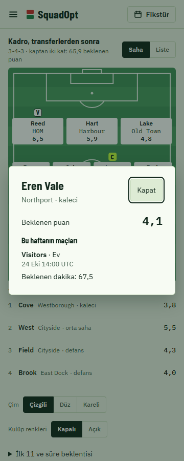
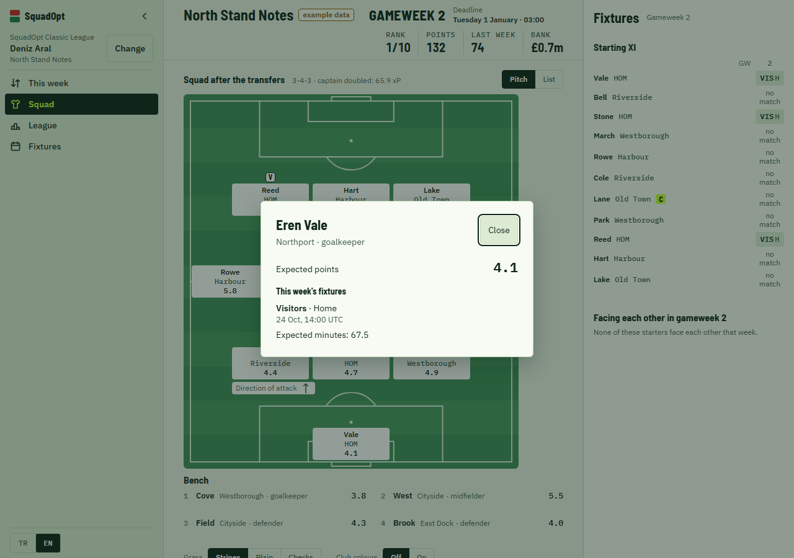

# Player details and pitch movement

Tap a player's plate or bench row to open their points, this week's fixtures and, for an
incoming transfer, the reason carried by the plan. A football forecast adds its minutes
estimate to the matching fixture. The fixture calendar must match the plan's capture and
season; an absent estimate is left out. A verified manager absence includes the exact
source words and a link to the club page.

Each plate has a named button with a touch target at least 44 px high. Enter opens it,
Escape or Close dismisses it, and focus returns to the button. The source link remains a
separate control. A plan that no longer draws the player, or another member or capture, closes
the details, and they stay closed until the player is chosen again.

When another plan arrives, retained players move from their actual previous screen positions
for 400 ms. The existing shared motion tokens and Web Animations API handle this without
an additional animation package. A first load, another member/capture, a resize or reopening
the pitch does not animate; reduced motion changes positions immediately. Interrupted
animations are cancelled, leaving the final layout in control.

The following screenshots use synthetic test data, taken by `e2e/player-details.spec.ts`.
That test also checks keyboard focus, Escape, mobile overflow, accessibility, and the same
final positions with motion enabled and disabled.

